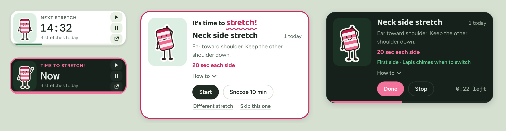
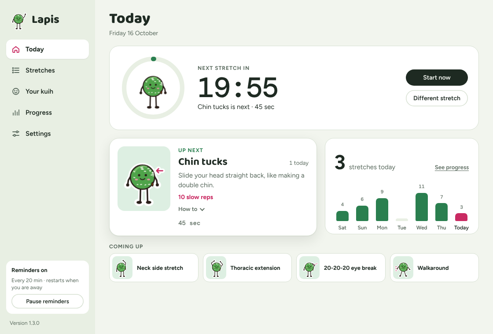
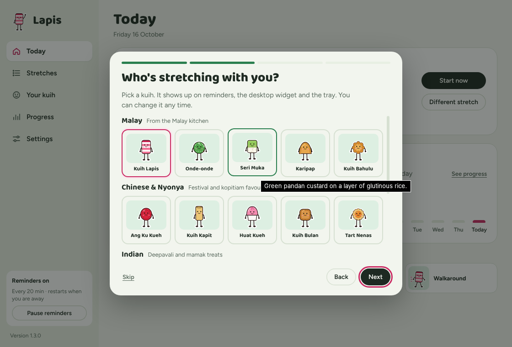
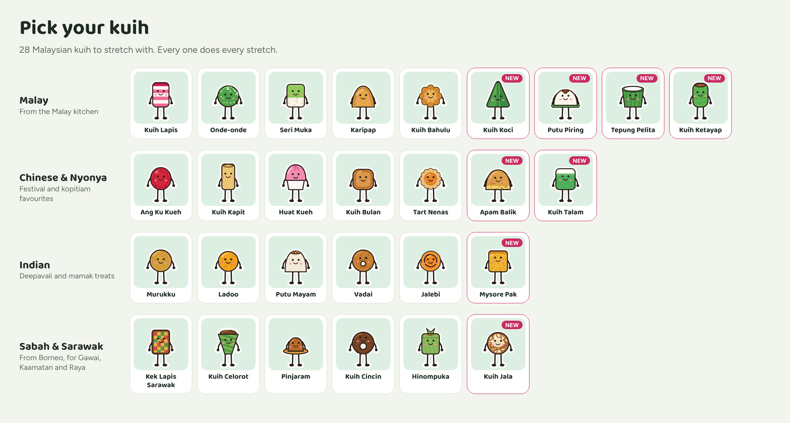

# Lapis

[](https://github.com/chowkuanlaw/lapis-stretch/releases/latest) [](https://github.com/chowkuanlaw/lapis-stretch/actions/workflows/release.yml) [](LICENSE) 

A small Windows desktop app that reminds you to stretch while you work. Every 20 minutes, Lapis (a kuih lapis with arms and legs, or any of 27 other Malaysian kuih you pick) pops up in the corner of your screen with one quick desk stretch, a timer, and a tally of how many you've done today.

<a href="https://apps.microsoft.com/detail/9nwmhw1373t4?mode=direct"></a>



## What it does

- **Pop-up reminder.** A card slides up in the bottom-right corner, above whatever app you're in, without stealing focus. Start, Snooze, Skip or pick a different stretch. It chimes, and for one-side-at-a-time stretches it chimes again when to switch sides.
- **Desktop widget.** A small countdown card that stays on top of your windows. Drag it anywhere. It hides itself while an app is full screen or presenting.
- **Tray icon.** Left-click to open Lapis, right-click to pause or quit. A ring around the kuih fills up as the next stretch gets closer. Closing the window keeps reminders running.
- **Pause for a while.** Pause for 30 minutes, 1 or 2 hours, until tomorrow, or until you resume, from the tray, the widget or the sidebar.
- **A tidy main window.** A sidebar with five pages: **Today** (countdown, daily goal, water, your next kuih, what's coming up), **Progress** (week chart, best day, streak, a month calendar, and water), **Stretches**, **Your kuih** and **Settings**.
- **Quick setup on first launch.** Say hello, choose English or Bahasa Melayu, pick your kuih, choose how often, set your working day and water reminders, done.
- **Working hours.** Reminds you only during your working days and hours (Monday to Friday, 9 to 6 by default) and skips lunch. Outside them Lapis rests, and the widget says when it's back.
- **Quiet in meetings.** While an app is full screen or presenting, or Windows Do not disturb is on, reminders wait and come 2 minutes after you're done.
- **Water reminders.** Every hour your kuih holds up a glass of water. Tap **Done, I drank** to count it toward your 8 glasses a day.
- **Daily goal and Friday summary.** Aim for 8 stretches a day, and get a look back at your week before you head home on Friday.
- **Streak saver.** One missed working day a week doesn't break your streak.
- **Kuih moods.** Your kuih looks proud at your goal, sleepy after a snooze, and a little sad after a few skips.
- **Balik kerja wrap-up.** When your working hours end, your kuih waves goodbye with your stretches, glasses and streak for the day.
- **Month calendar.** Progress shows each month as a calendar, shaded by how close each day got to your stretch or water goal.
- **Ramadan mode.** During the fasting month, water reminders pause and the walkaround (which ends with a drink) is left out until Raya.
- **Collect the kuih.** Start with four kuih and meet the other 24 as you stretch, from your first 5 stretches to a 1,000-stretch milestone.
- **Festive outfits.** For Hari Raya, Chinese New Year, Deepavali, Kaamatan, Gawai, Merdeka, Malaysia Day and Christmas, your kuih dresses up for the few days before and on the day itself.
- **English or Bahasa Melayu.** Every screen, reminder and the tray menu.
- **Nine stretches.** Chin tucks, neck side stretch, thoracic extension, shoulder rolls, seated twist, wrist stretch, a 20-20-20 eye break, stand and reach, and a 2-minute walkaround every few rounds. Each has a "How to" guide.
- **Time away counts as a break.** After 5 minutes of no keyboard or mouse activity, or when you lock your PC for a minute or more or sleep it, the timer restarts and any reminder that was waiting is cleared, so you're not nagged the moment you sit back down.
- **Settings.** Remind every 15–60 minutes, snooze 5–15 minutes, working hours, meetings, water, daily goal, chime sound and volume, text size, Light or Dark mode, widget on or off, optional Windows notification, start with Windows, language, and **Reset my data**.
- **Pick your kuih.** 28 Malaysian kuih: Malay, Chinese & Nyonya, Indian, and Sabah & Sarawak. Your kuih shows up on reminders, the desktop widget, the stretch list and the tray icon. Prefer to have them all now? Turn off **Collect kuih** in Settings.
- **Keeps itself up to date.** New versions download in the background; click **Restart to update** when it suits you.







## Install

**Easiest: get [Lapis Stretch from the Microsoft Store](https://apps.microsoft.com/detail/9nwmhw1373t4).** It's free, signed by Microsoft (so no "Windows protected your PC" warning), updates through the Store, and starts with Windows (you can turn that off in Windows **Settings → Apps → Startup**). The Store copy never connects to the internet.

**Or install from GitHub:**

1. Download **`Lapis-Setup-<version>.exe`** from the [latest release](../../releases/latest).
2. Run it. Lapis installs just for you (no admin rights needed), adds itself to the Start menu and opens.

The app isn't code-signed, so Windows may show "Windows protected your PC" the first time. Click **More info**, then **Run anyway**.

**Updates are automatic.** Lapis checks for a new version when it starts and once a day, downloads it in the background, and shows **Restart to update** in the Lapis window (and a Windows notification). If you don't restart, the update installs the next time you quit Lapis. Your settings and stretch history are kept. You can turn this off in Settings, and **Check now** checks on demand.

**Portable copy:** if you'd rather not install anything, download `Lapis-win-x64.zip`, unzip it anywhere and run `Lapis.exe`. The portable copy tells you when a new version is out, but you replace the folder yourself.

To uninstall, go to Windows **Settings → Apps → Installed apps → Lapis → Uninstall**. Your stretch history in `%APPDATA%\Lapis` is left in place; delete that folder too if you want it gone.

## Privacy

Lapis has no analytics, no accounts and no tracking. Fonts and images are bundled, and every window runs under a content security policy that only allows the app's own files. The only thing it saves is your settings, your stretch and water counts per day, and which kuih you've collected, in `%APPDATA%\Lapis\state.json` on your own PC.

To stay quiet in meetings, Lapis asks Windows two things when a reminder is due: whether an app is full screen or presenting, and whether Do not disturb is on (one read-only PowerShell command). It never uses your microphone or camera, and nothing leaves your PC. Turn off **Stay quiet in meetings and presentations** in Settings to skip these checks. To hide the desktop widget during full screen and presentations, Lapis asks Windows the first of these questions every few seconds; turn off **Hide the widget in full screen** to stop it.

The only network traffic is the update check against this repository's GitHub releases: when Lapis starts, once a day, and when you click **Check now**. It sends nothing about you or your stretches, just the standard request any download makes. Turn off **Update automatically** in Settings and Lapis only goes online when you click **Check now**.

**Reset my data** in Settings clears your history, collected kuih and badges from your PC, including the daily backup copy (it asks you to click twice). When you uninstall Lapis, it asks whether to remove your data too; choose No to keep it for a reinstall. It's all in the `%APPDATA%\Lapis` folder.

The full privacy policy is in [PRIVACY.md](PRIVACY.md). See [SECURITY.md](SECURITY.md) for how the app is locked down and how to report a security problem.

## Build from source

Run it in development (any OS, Node 22):

```bash
npm ci
npm start
```

Build the installer (on Windows):

```bash
npm ci
npm run dist:installer
# -> dist/installer/Lapis-Setup-<version>.exe and latest.yml
```

Build the portable zip (on Linux, macOS or WSL; needs `curl`, `unzip`, `zip`, `node` and `npm`):

```bash
./scripts/build-win.sh
# -> dist/Lapis/Lapis.exe and dist/Lapis-win-x64.zip
```

### Releasing

Releases are built by GitHub Actions (`.github/workflows/release.yml`) from the source, never on someone's PC:

1. Bump `version` in `package.json` and add a line to `CHANGELOG.md`.
2. Push a matching tag (`v1.1.1`), or open the Actions tab, pick **Release**, click **Run workflow** and enter the tag.

The workflow refuses to run if the tag doesn't match `package.json` or if any automatic test fails. It builds the installer on Windows and the portable zip on Linux, then publishes both. Installed copies of Lapis pick up the new release on their next check.

**Microsoft Store.** `.github/workflows/store.yml` builds the Store package (`.appx`), which Microsoft signs on upload. The Partner Center identity is kept in repository variables (`STORE_IDENTITY_NAME`, `STORE_PUBLISHER`, `STORE_PUBLISHER_NAME`, `STORE_DISPLAY_NAME`), not in the code. Set the variable `STORE_AUTO_SEND` to have each release also:

- `build`: build the Store package, for uploading by hand in Partner Center
- `draft`: upload it as a draft submission, for someone to review and press Submit
- `submit`: upload it and submit it for certification

`draft` and `submit` use the Microsoft Store Developer CLI with a Partner Center Microsoft Entra application (Manager role), whose details live only in repository secrets: `STORE_TENANT_ID`, `STORE_CLIENT_ID`, `STORE_CLIENT_SECRET`, `STORE_SELLER_ID`. Microsoft certifies every update before it reaches users.

## Project layout

```
main.js            timer, state, tray, updates and the app windows (runs in the main process)
quiet.js           the "quiet in meetings" checks (full screen, presenting, Do not disturb)
state.js           the settings defaults, and reading state.json back safely
preload.js         the small bridge the windows use to talk to main.js
renderer/          the UI: index.html, app.css, app.js, the mascot drawing, stretches and kuih (data.js), English and Malay text (i18n.js), fonts
assets/            app and tray icons
scripts/           portable build script, exe icon and Electron fuses
installer/         the uninstaller's "also remove my data?" question
test/              automatic tests, run with `npm test` and before every release
package.json       app details, plus the installer settings under "build"
```

## Feedback

Found a bug or have a stretch you'd like Lapis to suggest? [Open an issue](../../issues/new/choose).

## Licence

Lapis is released under the [MIT licence](LICENSE): you're free to use, change and share it, including in your own projects, as long as you keep the copyright notice.

## Credits

Fonts: [Baloo 2](https://github.com/EkType/Baloo2), [Figtree](https://github.com/erikdkennedy/figtree) and [DM Mono](https://github.com/googlefonts/dm-mono), under the SIL Open Font License (see `renderer/fonts/LICENSES.txt`). Built with [Electron](https://www.electronjs.org/).

Stretch guidance is general wellness information, not medical advice. Stop any stretch that hurts.
